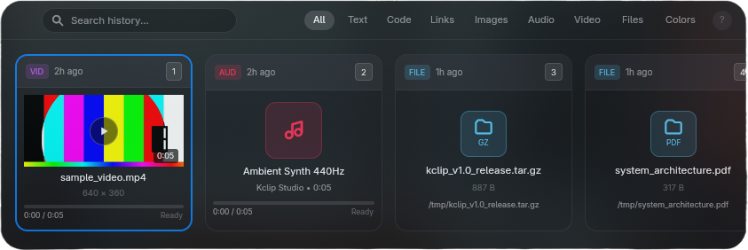

<p align="center">
  
</p>

# kclip

A minimal, keyboard-first Wayland clipboard manager written in Rust, built with GPUI.



## Overview

`kclip` runs as a lightweight background daemon monitoring Wayland clipboard selections via `ext-data-control-v1` (with fallback to `zwlr-data-control-v1`). When summoned with a global hotkey, it presents an instant, translucent horizontal card carousel floating above the desktop.

## Key Features

- **Subsystem Isolation**: Pure Wayland data-control capture daemon decoupled from the GPUI rendering thread.
- **9 Specialized Content Types**: Tailored card renderers for Text, Code, Links, Images, Audio, Video, Files, Colors, and HTML.
- **Rich Media & Video Previews**: Headless `mpv` integration with sample frame extraction, real-time waveform scrub, and precision seek (`--hr-seek=always`).
- **OpenGraph Link Previews**: Asynchronously fetches site titles, favicons, and prominent 90px banner images for copied URLs.
- **Fast Full-Text Search**: SQLite FTS5 search with instant filtering and live chip switching.
- **Content-Addressable Storage**: Fast SQLite WAL database for metadata and indexed text, offloading large binary blobs and images to disk by SHA-256 hash.

## Content Kinds

| Kind       | Badge  | Features                                                                 |
| :--------- | :----- | :----------------------------------------------------------------------- |
| **Text**   | `TXT`  | Word-wrapped preview, dynamic scrollbar for long texts                   |
| **Code**   | `CODE` | Syntax language detection and scrollable snippet                         |
| **Links**  | `URL`  | OpenGraph preview banner, clean URL tracking stripping, domain badge     |
| **Images** | `IMG`  | High-quality downsampled thumbnail preview with dimensions and file size |
| **Audio**  | `AUD`  | Duration, metadata tags, interactive progress bar with RMB seek          |
| **Video**  | `VID`  | Extracted preview frames, resolution, duration, RMB drag seeking         |
| **Files**  | `FILE` | File extension badge, file size, filename, and path                      |
| **Colors** | `HEX`  | Large color swatch preview for HEX, RGB, and HSL values                  |
| **HTML**   | `HTML` | Rendered text excerpt                                                    |

## Keyboard Controls

Press `?` inside kclip to view the built-in interactive cheatsheet.

## Requirements

- **Linux** with a Wayland compositor supporting `ext-data-control-v1` or `zwlr-data-control-v1` (such as Umbriel, Hyprland, Sway, River, or KDE Wayland).
- **Runtime tools** (optional, recommended for rich media):
  - `ffmpeg` / `ffprobe`: for video frame extraction and audio metadata probing.
  - `mpv`: for headless audio/video playback and preview scrubbing.
  - `gio` / `gtk-launch`: for application launcher integration.

## Building from Source

Ensure you have Rust (stable 1.85+) installed:

```bash
git clone https://github.com/koresent/kclip.git
cd kclip
cargo build --release
```

The compiled binary will be placed at `target/release/kclip`.

Install it to your local binary path:

```bash
cp target/release/kclip ~/.local/bin/kclip
```

## Running as a Systemd Service

Create a user service file at `~/.config/systemd/user/kclip.service`:

```ini
[Unit]
Description=kclip Wayland Clipboard Daemon
PartOf=graphical-session.target
After=graphical-session.target

[Service]
Type=simple
ExecStart=%h/.local/bin/kclip daemon
Restart=on-failure
RestartSec=2s

[Install]
WantedBy=graphical-session.target
```

Enable and start the service:

```bash
systemctl --user daemon-reload
systemctl --user enable --now kclip.service
```

## Compositor Hotkey Binding

Bind `kclip toggle` to your preferred shortcut.

### Umbriel / Hyprland

```ini
bind = MOD_SUPER, V, exec, kclip toggle
```

Calling `kclip toggle` when the window is already open gracefully closes it.

## Configuration

kclip reads configuration from `~/.config/kclip/config.yaml`. If not present, built-in defaults are used.

See [docs/CONFIGURATION.md](docs/CONFIGURATION.md) for full configuration reference.
