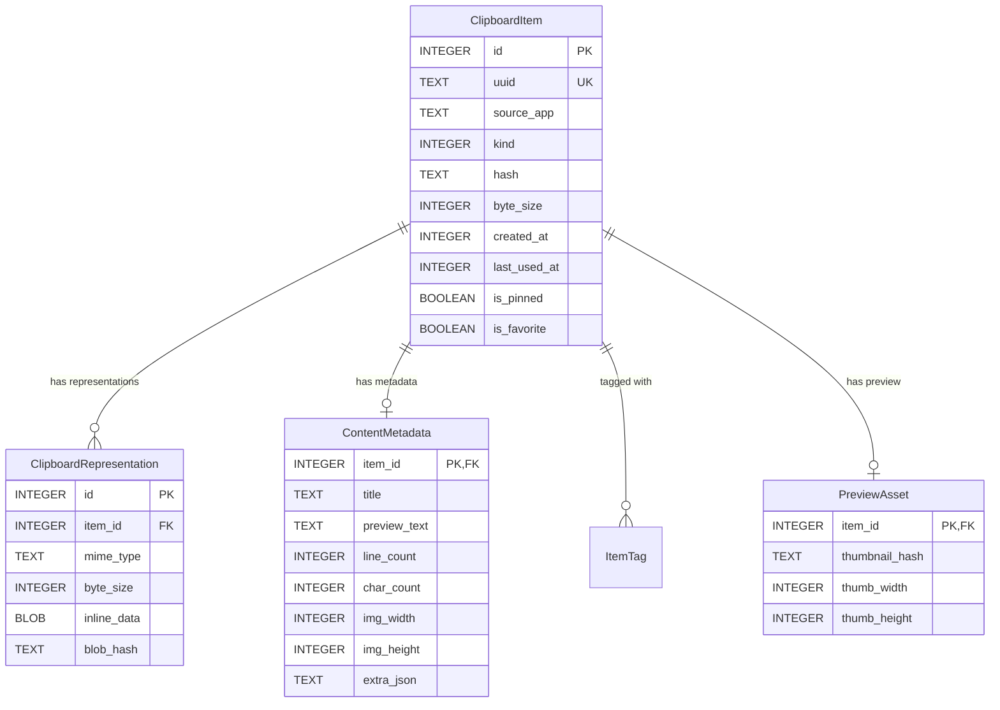

# Data Model & Storage Specification: kclip

This document defines the persistent data model, SQLite database schema, FTS5 search indexing, and blob storage hierarchy for **kclip**.

---

## 1. Storage Overview

kclip uses a hybrid storage model:
1. **SQLite Database**: Stores structured metadata, classifications, search tokens, small text payloads (< 64 KB), and relationships.
2. **Content-Addressable File Store (Blobs)**: Stores large payloads (raw images, audio, large documents, high-res previews) on disk at `~/.local/share/kclip/blobs/<sha256>`.
3. **In-Memory Cache**: Keeps recent item previews and thumbnail handles hot in memory for instantaneous scrolling without disk hits.

Database path: `~/.local/share/kclip/kclip.db`

---

## 2. Entity Relational Model



---

## 3. SQLite DDL Schema

```sql
-- Enable Write-Ahead Logging for high concurrent read/write throughput
PRAGMA journal_mode = WAL;
PRAGMA synchronous = NORMAL;
PRAGMA foreign_keys = ON;

-- 1. Main Clipboard Items Table
CREATE TABLE IF NOT EXISTS clipboard_items (
    id INTEGER PRIMARY KEY AUTOINCREMENT,
    uuid TEXT NOT NULL UNIQUE,
    source_app TEXT,
    kind INTEGER NOT NULL,            -- 0=Text, 1=Code, 2=Url, 3=Image, 4=Color, 5=Files, 6=Html, 7=Binary
    hash TEXT NOT NULL,               -- SHA-256 of primary payload for deduplication
    byte_size INTEGER NOT NULL,
    created_at INTEGER NOT NULL,      -- Unix timestamp (milliseconds)
    last_used_at INTEGER NOT NULL,    -- Unix timestamp (milliseconds)
    is_pinned INTEGER NOT NULL DEFAULT 0,
    is_favorite INTEGER NOT NULL DEFAULT 0
);

-- 2. Representations Table (One item can offer multiple MIME representations)
CREATE TABLE IF NOT EXISTS clipboard_representations (
    id INTEGER PRIMARY KEY AUTOINCREMENT,
    item_id INTEGER NOT NULL REFERENCES clipboard_items(id) ON DELETE CASCADE,
    mime_type TEXT NOT NULL,
    byte_size INTEGER NOT NULL,
    inline_data BLOB,                 -- Populated if byte_size <= 65536
    blob_hash TEXT,                   -- Referenced in filesystem if byte_size > 65536
    UNIQUE(item_id, mime_type)
);

-- 3. Content Metadata Table
CREATE TABLE IF NOT EXISTS content_metadata (
    item_id INTEGER PRIMARY KEY REFERENCES clipboard_items(id) ON DELETE CASCADE,
    title TEXT,                       -- Custom or inferred title
    preview_text TEXT,                -- Sanitized plain text excerpt for display & indexing
    line_count INTEGER,
    char_count INTEGER,
    img_width INTEGER,
    img_height INTEGER,
    extra_json TEXT                   -- Extensible attributes (URL domain, color hex, code language)
);

-- 4. Preview Assets Table (Thumbnails, rendered previews)
CREATE TABLE IF NOT EXISTS preview_assets (
    item_id INTEGER PRIMARY KEY REFERENCES clipboard_items(id) ON DELETE CASCADE,
    thumbnail_hash TEXT NOT NULL,     -- Blob hash in filesystem for 200x200 thumbnail
    thumb_width INTEGER NOT NULL,
    thumb_height INTEGER NOT NULL
);

-- 5. Full-Text Search (FTS5) Virtual Table
CREATE VIRTUAL TABLE IF NOT EXISTS clipboard_items_fts USING fts5(
    preview_text,
    title,
    source_app,
    content='content_metadata',
    content_rowid='item_id',
    tokenize='unicode61 remove_diacritics 2'
);

-- FTS Synchronization Triggers
CREATE TRIGGER IF NOT EXISTS trg_content_metadata_ai AFTER INSERT ON content_metadata BEGIN
    INSERT INTO clipboard_items_fts(rowid, preview_text, title, source_app)
    VALUES (
        new.item_id,
        new.preview_text,
        new.title,
        (SELECT source_app FROM clipboard_items WHERE id = new.item_id)
    );
END;

CREATE TRIGGER IF NOT EXISTS trg_content_metadata_ad AFTER DELETE ON content_metadata BEGIN
    INSERT INTO clipboard_items_fts(clipboard_items_fts, rowid, preview_text, title, source_app)
    VALUES('delete', old.item_id, old.preview_text, old.title, '');
END;

CREATE TRIGGER IF NOT EXISTS trg_content_metadata_au AFTER UPDATE ON content_metadata BEGIN
    INSERT INTO clipboard_items_fts(clipboard_items_fts, rowid, preview_text, title, source_app)
    VALUES('delete', old.item_id, old.preview_text, old.title, '');
    INSERT INTO clipboard_items_fts(rowid, preview_text, title, source_app)
    VALUES (
        new.item_id,
        new.preview_text,
        new.title,
        (SELECT source_app FROM clipboard_items WHERE id = new.item_id)
    );
END;

-- 6. Performance Indices
CREATE INDEX IF NOT EXISTS idx_items_last_used ON clipboard_items(last_used_at DESC);
CREATE INDEX IF NOT EXISTS idx_items_kind_last_used ON clipboard_items(kind, last_used_at DESC);
CREATE INDEX IF NOT EXISTS idx_items_hash_kind ON clipboard_items(hash, kind);
CREATE INDEX IF NOT EXISTS idx_items_pinned ON clipboard_items(is_pinned, last_used_at DESC);
CREATE INDEX IF NOT EXISTS idx_reps_item_id ON clipboard_representations(item_id);
```

---

## 4. Deduplication & Lifecycle Strategy

### 4.1 Deduplication on Capture
When a new clipboard snapshot is processed:
1. Compute `hash = SHA256(canonical_payload)` and determine `kind`.
2. Execute lookup:
   ```sql
   SELECT id FROM clipboard_items WHERE hash = :hash AND kind = :kind;
   ```
3. If an existing entry is found:
   - Update its `last_used_at = now()` and bump it to the front of history.
   - Do not re-allocate new database rows or blob files.
4. If no entry is found:
   - Insert new row into `clipboard_items`.
   - Store representations and metadata within a single transaction.

### 4.2 Retention Policy & Blob Pruning
- Run on startup or periodic timer:
  ```sql
  DELETE FROM clipboard_items 
  WHERE is_pinned = 0 AND is_favorite = 0 
  AND created_at < :retention_cutoff_timestamp;
  ```
- Any blob files in `~/.local/share/kclip/blobs/` whose hashes are no longer present in `clipboard_representations.blob_hash` or `preview_assets.thumbnail_hash` are deleted from disk.
